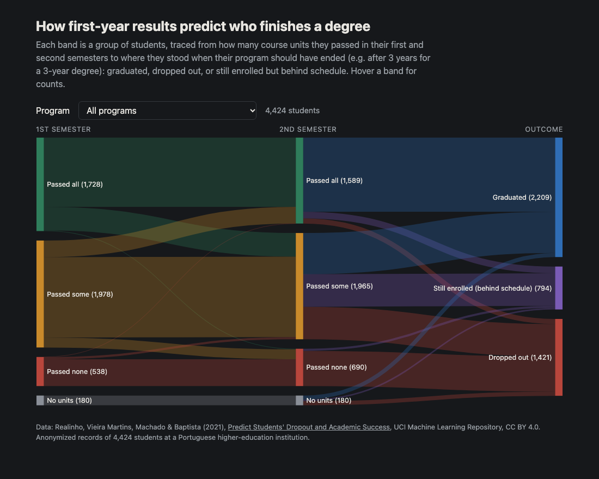

# Student Flow Sankey

An interactive Sankey diagram that traces students from their first-year course results to where they stood when their program should have ended (graduated, dropped out, or still enrolled but behind schedule), with a filter for each degree program.

It grew out of a 2018 undergraduate research project on student retention that asked: *how early can you see who will leave a program?* In this dataset the answer is the second semester. Of the 690 students who passed none of their second-semester units, **not one graduated**.



## Data

[Predict Students' Dropout and Academic Success](https://doi.org/10.24432/C5MC89), from the UCI Machine Learning Repository: 4,424 **anonymized** student records from a higher-education institution in Portugal, published under [CC BY 4.0](https://creativecommons.org/licenses/by/4.0/).

> Realinho, V., Vieira Martins, M., Machado, J., & Baptista, L. (2021). *Predict Students' Dropout and Academic Success* [Dataset]. UCI Machine Learning Repository. https://doi.org/10.24432/C5MC89

`data/students.csv` is the unmodified file from UCI.

## How it works

```
data/students.csv  ->  build_flows.py  ->  docs/flows.json  ->  docs/index.html (D3 + d3-sankey)
```

Each student is placed in a group for each semester based on curricular units **approved vs. enrolled**: *Passed all*, *Passed some*, *Passed none*, or *No units* (enrolled in nothing that term). The outcome is each student's status **at the end of their program's normal duration** (for example, after 3 years of a 3-year degree), as defined by the dataset: *Graduated*, *Dropped out*, or *Still enrolled (behind schedule)*, meaning they hadn't finished on time but hadn't left either.

`build_flows.py` counts how students move from semester 1 → semester 2 → final outcome. It writes one graph for all students plus one per program, which the page's dropdown switches between.

## Run it

Python 3.9+, standard library only.

```bash
python3 build_flows.py
python3 -m http.server 8000 --directory docs   # then open http://localhost:8000
```

`docs/` is static, so GitHub Pages can serve it directly (Settings → Pages → `main` branch, `/docs` folder).

## Stack

Python (data pipeline) · D3.js v7 + d3-sankey (visualization) · static HTML
